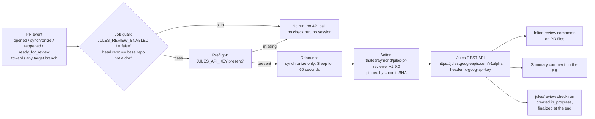

# Jules PR Review — Operations Manual

HydroPulse · repo `Rossonerian/hydropulse` · branch `main` · 24-hour hackathon, 4 people.

**Rule of the document:** this is an operations manual, not a pitch. Every fact below is either
verified against the third-party action's source at its pinned SHA, against the workflow files in
this repository, or is explicitly marked as not yet verified in the
[verification status](#verification-status) table at the end.

---

## ⚠️ Sunset notice

> **Google announced on 2026-10-29 that Jules winds down on 2026-12-31. After 2026-11-11, Jules
> becomes read-only until the end of the year.** Quoting the announcement:
>
> "You have until November 11, 2026 to continue finishing up sessions. After November 11, 2026,
> we will be turning Jules to read-only until the end of the year."

Consequences for this repository:

- **Review sessions may stop working after 2026-11-11.** The action may fail to create sessions
  (check run goes red) or fail with a clear error even earlier, as Google narrows the service.
- **The integration is intentionally isolated** — only
  `.github/workflows/jules-pr-review.yml` and `.github/jules-review-rules.md` sit on the review
  path (plus the optional read-only `.github/workflows/jules-preflight.yml` diagnostic), so it can
  be replaced by another reviewer without touching any other CI/CD, workflow, or source file.
- **Nothing blocks merging when it stops working.** The `jules/review` check is not a required
  status check (see [section 14](#14-why-jules-is-not-a-required-check)), so a red or absent
  check is cosmetic. Keep working; merge as normal.

---

## Table of contents

1. [Architecture](#1-architecture)
2. [Required secret](#2-required-secret)
3. [Connecting the repo to Jules](#3-connecting-the-repo-to-jules)
4. [Enable / disable](#4-enable--disable)
5. [Trigger events](#5-trigger-events)
6. [Concurrency](#6-concurrency)
7. [Timeouts](#7-timeouts)
8. [Rate limits and quota](#8-rate-limits-and-quota)
9. [Reading inline comments](#9-reading-inline-comments)
10. [Deduplication](#10-deduplication)
11. [Resolved threads](#11-resolved-threads)
12. [Retrying a failed workflow](#12-retrying-a-failed-workflow)
13. [Diagnosing a missing review](#13-diagnosing-a-missing-review)
14. [Why Jules is not a required check](#14-why-jules-is-not-a-required-check)
15. [Manual review when Jules is unavailable](#15-manual-review-when-jules-is-unavailable)
- [Known limitations](#known-limitations)
- [Verification status](#verification-status)

---

## 1. Architecture

The workflow is a **thin, disposable adapter**. Swapping vendors means replacing one workflow file
(`.github/workflows/jules-pr-review.yml`) and one rules file (`.github/jules-review-rules.md`).
Nothing else in CI/CD or the codebase depends on Jules.



Key properties:

- The action **hard-refuses to run on `pull_request_target`** and refuses any event other than
  `pull_request`. It cannot be mis-triggered.
- The rules file is loaded from the **base SHA** (the target branch), so a PR cannot weaken the
  rules used to review itself.
- The action creates the `jules/review` check run as `in_progress`, posts inline comments plus a
  summary comment, then **finalizes** the check run.
- Runtime exits follow a fixed failure taxonomy (`config` / `auth` / `quota` / `parse` /
  `timeout` / `unknown`). Every runtime exit either **never creates a check run** (config / event
  errors) or **finalizes it with a `failure` conclusion** — the action never leaves a stale
  `in_progress` check run of its own making (except when the workflow job itself is cancelled by
  concurrency; see [section 6](#6-concurrency)).

## 2. Required secret

Exactly one secret: **`JULES_API_KEY`**, a GitHub Actions **repository secret**.

**Create the key:**

1. Sign in at <https://jules.google.com>.
2. Go to **Settings → API** and create an API key.
3. Copy the key once — display or copy behavior for keys can change, so treat the moment of
   creation as the only reliable time to retrieve it.

**Install the secret (either method):**

Using the GitHub CLI:

```bash
gh secret set JULES_API_KEY   # paste the key when prompted, press Enter twice
```

Or via the web UI: **Settings → Secrets and variables → Actions → New repository secret**,
name `JULES_API_KEY`.

**Hard rules:**

- Never put the key in a **repository variable** (variables are not encrypted) or in a
  **committed file** or **`.env`**.
- Never echo it in logs. The preflight step in the workflow checks only that it is non-empty and
  **never prints the value**.
- **Keys found publicly exposed are auto-disabled by Google.** If the key stops working with an
  `auth` failure, check whether it leaked, revoke it, and create a new one.

## 3. Connecting the repo to Jules

The Jules REST API only sees repositories accessible through the **Jules GitHub app**. If the
repository is not connected, **session creation fails** even with a valid API key, because the
API only resolves repositories listed under `sources/github/<owner>/<repo>`.

**Do this once for the `Rossonerian` account:**

1. At <https://jules.google.com>, install the Jules GitHub app for the `Rossonerian` account.
2. Grant it access to the `hydropulse` repository.

**Verify (read-only, does not consume quota):**

The preflight workflow `.github/workflows/jules-preflight.yml` calls `GET /v1alpha/sources` and
prints **only a connected yes/no and a source count** — never the key, never the payload. This
endpoint call does not create sessions and does not consume review quota.

Run it from **Actions → "Jules preflight (connectivity check)" → Run workflow** (branch `main`).

The same verification, manually, from your laptop:

```bash
curl -sS -o /dev/null -w '%{http_code}\n' \
  -H "x-goog-api-key: ${JULES_API_KEY}" \
  "https://jules.googleapis.com/v1alpha/sources"
# 200 = key accepted and repo access readable
# 401/403 = key invalid, revoked, or auto-disabled
# 429 = rate limited / quota exhausted at the API level
```

To confirm the specific repo is visible (read-only):

```bash
curl -sS -H "x-goog-api-key: ${JULES_API_KEY}" \
  "https://jules.googleapis.com/v1alpha/sources" \
  | jq -e '.sources[] | select(.name == "sources/github/Rossonerian/hydropulse")' \
  && echo "hydropulse is connected" || echo "hydropulse is NOT connected"
```

## 4. Enable / disable

Controlled by the repository variable **`JULES_REVIEW_ENABLED`**:

| Variable state | Behavior |
| --- | --- |
| Unset | Enabled |
| Any value other than exactly `false` | Enabled |
| Exactly `false` | Disabled — the job is skipped with **no workflow edit** |

```bash
# Disable (skips the job on every PR; no workflow edit, no branch protection change)
gh variable set JULES_REVIEW_ENABLED --body false

# Re-enable by deleting the variable (unset = enabled)
gh variable delete JULES_REVIEW_ENABLED
```

**Per-PR escape hatch:** add the `jules-override` label to a single PR to bypass the review for
that PR only. Use it for trivial PRs (typos, doc-only changes) to save quota.

## 5. Trigger events

The workflow triggers on `pull_request` with exactly four types, regardless of the target/base branch:

| Event type | Meaning |
| --- | --- |
| `opened` | A new PR is created — full initial review. |
| `synchronize` | New commits are pushed to the PR branch — debounced 60 s, then an incremental review (see [section 10](#10-deduplication)). |
| `reopened` | A previously closed PR is re-opened. |
| `ready_for_review` | A draft is marked ready — drafts are otherwise skipped before any API call. |

Notes:

- The action itself **hard-refuses to run on `pull_request_target`** and refuses any event other
  than `pull_request`. The workflow additionally never declares `pull_request_target`.
- **Why `pull_request_target` is forbidden:** it runs in the context of the base branch with a
  base-repo **write token**, while checking out and reviewing diffs. Combined with content
  supplied by the PR diff (which, from a fork, is attacker-controlled), this exposes
  prompt injection against a write-scoped workflow. `pull_request` runs with the PR branch's
  own read token and this repository's secrets only — and our job guard additionally rejects
  forks outright.

## 6. Concurrency

One review **in flight per PR**, enforced by:

```yaml
concurrency:
  group: jules-review-${{ github.event.pull_request.number }}
  cancel-in-progress: true
```

**What happens when a new commit arrives mid-review, exactly:**

1. The old run receives a **cancellation**. Its in-flight Jules session is **abandoned** — the
   action archives sessions best-effort on normal exits; a hard cancellation may leave one open
   session in the Jules UI. That is **harmless**; close it there if you happen to see it.
2. The new commit starts its own run, which posts its own comments and finalizes its own
   `jules/review` check run. The new commit's result is the one that matters.
3. A cancelled run can leave an **`in_progress` check run on the OLD commit**. This is
   **cosmetic**: the check is not required (see [section 14](#14-why-jules-is-not-a-required-check)),
   the old commit is superseded, and the new commit has its own, accurately reported check run.
   Ignore the stale blob on the old commit's Checks tab.

## 7. Timeouts

Two levels:

| Level | Value | Purpose |
| --- | --- | --- |
| Action (`timeout_minutes`) | **25** | Jules session wall-clock per attempt. The action allows exactly ONE retry, and ONLY on timeout. |
| Workflow job (`timeout-minutes`) | **65** | Backstop so a runaway job can never burn the runner for hours. |

**Arithmetic:** worst case review time is 2 × 25 = **50 min** (one wait plus the single allowed
timeout retry; no other failure is ever retried) plus ~1 min debounce and ~3 min
preflight/submission/finalisation ≈ **54 min**, inside the 65 min job cap, with ~11 min headroom.

Note on the setting: the action itself does not reject `timeout_minutes` values above 1, but the
upstream README says real reviews take **15-25 min** and **never to go below 20** — shorter values
produce reviews that time out before Jules finishes. 25 is chosen because `diff_mode: agentic`
inspects the whole repository rather than a truncated diff, and every timeout costs **two** quota
sessions (the attempt plus the single automatic retry).

## 8. Rate limits and quota

The Jules free tier allows **15 sessions per 24h**. Quota exhaustion surfaces as an HTTP 429,
which the action classifies as a **`quota` failure**: the check run goes red with an actionable
message, and there is **no retry loop** — quota errors fail fast, because retrying cannot help.

**How to reduce consumption:**

- Leave the **debounce** in place (60 s on `synchronize`): bursts of autonomous-agent pushes
  collapse into one session instead of one session per push.
- Keep **`session_reuse` off** (it is off; nothing in the workflow turns it on).
- **Do not re-run the workflow** for the same commit — a re-run creates a new Jules session and
  costs quota (see [section 12](#12-retrying-a-failed-workflow)).
- Use the **`jules-override` label** for trivial PRs (doc-only, typo fixes) to skip them entirely.

**Session budget math for the 4-person team:** the single repository secret means one shared
quota pool — **15 sessions / 24h team-wide**, roughly **3–4 sessions per person** if evenly
split. Treat it as a scarce resource: prefer one review per substantial push, not per commit.

## 9. Reading inline comments

Where to look, in order:

1. **Files changed tab** — the inline review comments appear anchored to the exact lines Jules
   flagged. Each carries a **severity** tag (e.g. High / Warning / Info) and a **confidence**
   tag. With `min_severity_to_report: warning`, Info-level findings are filtered out and never
   appear.
2. **The summary comment** — a single PR comment restating every finding, plus, for large PRs,
   the list of files that were **NOT reviewed** (under the `large_pr_strategy: prioritize`
   default, the highest-churn files that fit the budget are reviewed and the rest are reported
   as skipped). **The comment is the complete record** — treat it as the source of truth.
3. **The Checks tab** — the `jules/review` check run carries the annotations GitHub renders on
   the diff. **Annotations are capped at 50 per run**; anything beyond the cap exists only in
   the summary comment.

## 10. Deduplication

`dedupe: true` is set. On a new push (`synchronize`):

- The action sends **only the incremental `before..head` diff** — the changes since the commit
  the previous review covered — not the whole PR again.
- It also passes **its own still-open review threads**, so:
  - findings that were **fixed** in the new diff are **marked resolved** automatically, and
  - findings that are **still open are not re-reported**.

A finding is re-reported **only if the new diff introduces a new or materially different
instance** of the problem. Net effect: repeated pushes do not spam the PR with repeats.

## 11. Resolved threads

When a finding is fixed, the action resolves the corresponding thread itself. **Do not resolve
threads manually** if you want dedupe to keep working — dedupe tracks its open threads through
its own thread state. A manually resolved thread simply stops being listed; the dedupe
bookkeeping for it is lost, so an equivalent finding may be re-reported. If you disagree with a
finding, reply to the thread explaining why; leave resolution to the action or to Hardhik.

## 12. Retrying a failed workflow

If the workflow job itself failed (quota, auth, timeout after both attempts, action crash):

1. Go to **Actions → the failed run**.
2. Click **"Re-run failed jobs"**.

What a re-run does and does not do:

- A re-run **creates a new Jules session** — it costs quota. Do not re-run for a failure that
  reads as `quota` until the quota window has reset.
- **Re-running does not change the code being reviewed.** If the review flagged real issues, a
  re-run returns the same findings. The fix for review findings is a new commit, not a re-run.

**To re-run only for the newest commit:** do not re-run the old, superseded run. The newest
commit on the PR already has its own run (concurrency guarantees only one in flight); if it
failed, re-run **that** run from its own page. If no run exists for the newest commit, push an
empty marker commit (`git commit --allow-empty -m "retrigger review"`) or close and re-open the
PR to get a fresh run against the current head.

## 13. Diagnosing a missing review

If a PR got no review at all (no comments, no `jules/review` check), walk this checklist in
order — each item explains itself and is cheap to test:

1. **Is the PR a draft?** Drafts are skipped before any API call. Mark ready for review or
   expect no review until then.
2. **Is it from a fork?** `skip_forks: true` and the job guard both reject forks. Only
   same-repository branches are reviewed.
3. **Does it have the `jules-override` label?** Anyone can add it by accident. Remove it to
   trigger a review on the next event (a push or a manual trigger).
4. **Is `JULES_REVIEW_ENABLED` set to `false`?** Check `gh variable list`. Any value other than
   exactly `false` (including unset) means enabled.
5. **Is the workflow file present on `main`?** It must be merged to `main` before ordinary PRs get
   reviewed. A PR that itself introduces the workflow can trigger it from its own head, but the
   **rules file is always read from the base SHA**, so that first run happens without project
   policy — the action logs a warning and continues with its default prompt. Merge this workflow
   and `.github/jules-review-rules.md` to `main` first, then review real branches.
6. **Is the `JULES_API_KEY` secret present and valid?** Run the **Jules preflight** workflow
   (Actions → Jules preflight → Run workflow). It reports missing-key, auth-failure (401/403)
   and quota (429) cases without spending a session.
7. **Did the job get cancelled by a newer push?** Check the Actions tab for a cancelled run of
   the same PR; the newest commit's run is the one with the verdict.
8. **Was the repo connected to Jules?** See [section 3](#3-connecting-the-repo-to-jules). If the
   repo is not under `sources/github/Rossonerian/hydropulse`, session creation fails.
9. **Read the run log** for the `review_failed` step and its `kind` field. Map it with the table
   below.
10. **Read the check run summary text** (Checks tab → `jules/review` → the failing summary line)
    — it states the failure class in plain language.

Failure taxonomy (`kind` → meaning → action):

| `kind` | Meaning | Action |
| --- | --- | --- |
| `config` | Missing key, missing/invalid workflow input, unsupported event. | Fix the noted configuration. No check run was created (config errors pre-empt check-run creation). |
| `auth` | `JULES_API_KEY` rejected (401/403) or revoked/auto-disabled. | Create a fresh key at jules.google.com (Settings → API), `gh secret set JULES_API_KEY`. |
| `quota` | HTTP 429 — the free tier's 15 sessions / 24h is exhausted. | Wait for the window to reset. Do not retry in a loop. Use the wait time to do a manual review (section 15). |
| `parse` | Jules returned a response the action could not parse. | Read the summary in the check run; re-run once if you judge it worth a session. Otherwise proceed per section 15. |
| `timeout` | Session exceeded `timeout_minutes`. The action retried once automatically — both attempts timed out. | Consider whether the PR is unusually large; `large_pr_strategy: prioritize` already trims it. Re-run once only if you suspect a transient Jules slowdown. |
| `unknown` | Anything else — action crash, upstream HTTP error outside the above classes. | Read the raw step log. Treat as a review outage: PR stays mergeable (section 14). |

## 14. Why Jules is not a required check

The `jules/review` check is **advisory-only** and must stay that way:

- Team of 4 people in a 24-hour sprint — a blocking review loop would serialize the whole team
  on a single external service.
- The model can be **wrong** — findings are hypotheses, not verified defects.
- Quota can be **exhausted** — 15 sessions / 24h shared team-wide, and a quota failure is not a
  signal about the code at all.
- A **false negative must never block a verified implementation.** The team's own tests,
  contract checks, and demo rehearsals are the merge criterion. Jules is a second pair of eyes,
  not a gate.

Configuration that enforces this, all already in place:

- `fail_on: never` — the check run stays **GREEN** for any verdict (approve / comment / block).
  It only turns red when the action itself breaks (quota, auth, timeout, parse failure, crash).
  In that case the workflow job also fails — but the check is optional, no protection rule
  references it, and therefore the PR stays mergeable. A green job with a red check is not the
  goal; a merge that is never blocked is.
- **`block_on` is deliberately unset** — it would override `fail_on` and turn verdicts into
  merge gates. Do not add it.
- **No branch protection or ruleset requires `jules/review`**, and none should.

**⚠️ Explicit warning:** if someone later adds a required status check for `jules/review`
(Settings → Branches, or a repository ruleset), a red Jules check **WILL block merges** —
including during a quota outage, an upstream Jules outage, or the service wind-down. **Do not do
that.** **Hardhik remains the final merge authority**, human-reviewed, regardless of what Jules
says.

## 15. Manual review when Jules is unavailable

Then *do this checklist instead.* It is what the teammate PR'ing and Hardhik (merger) run
through for every HydroPulse PR. Keep it in review for any PR over ~30 lines of diff.

- [ ] **Contract / API shapes** — endpoint payloads match the agreed FastAPI response models;
      all error paths present (404 handled, 422 as a FastAPI validation **array**, not string);
      no breaking rename of an endpoint Badri is already consuming.
- [ ] **WNTR invariants** — simulation uses `WNTRSimulator` (no `EpanetSimulator` in the leak
      path), the network parses cleanly, and the fixture used is the agreed snapshot (no
      regenerated bases per PR).
- [ ] **Detection math** — cosine similarities are computed on the observed pressure-drop vector,
      zero-norm rows are guarded, confidence is reported on a 0-100 scale while `node_heatmap`
      stays 0-1, and the leak-area estimate is clamped to the 0.5-100 cm2 range. No invented
      accuracy numbers: confidence is not benchmark accuracy.
- [ ] **Isolation logic** — `recommended_valves_to_close` is every open pipe incident to the
      leaked node; after removing them, every junction that can no longer reach a reservoir or
      tank appears in `isolated_node_ids`, and the affected-household count matches.
- [ ] **Frontend contract + lat/lng** — API objects are consumed as-is with snake_case keys;
      map coordinates are `(lat, lng)` in that order everywhere (a single swap silently moves
      every marker off the map); both `VITE_USE_MOCK=true` and the live-API path are exercised if
      the payload changed.
- [ ] **Offline demo** — anything the demo needs (mock data, fixtures, deck assets, fonts) is
      bundled, not fetched at runtime; the deck opens without a network connection.
- [ ] **Run the tests locally** (adjust once Gangu's Makefile targets land):
      ```bash
      pytest -q                                   # backend test suite, must be green
      uvicorn backend.main:app --host 0.0.0.0 --port 8000   # backend on :8000
      cd frontend && npm run dev -- --host        # frontend on :5173
      cd frontend && npm run build                # must pass before merge
      ```
      If `make test` / `make backend` / `make frontend` exist in `Makefile`, those are the
      canonical entry points — use them instead.

If all boxes tick and Hardhik agrees, **merge without waiting for Jules.** Do not block the
merge on a missing review — go straight to the manual checklist.

---

## Known limitations

- **The third-party action is a single-maintainer project with 9 stars** (`thalesraymond/jules-pr-reviewer`,
  MIT, node24). Pinned by full commit SHA (`53f8cf09e8e6ceecffe5d57cccc1a1f4964a28de`, v1.9.0)
  for exactly that reason — treat any move off the pinned SHA as a deliberate audit, not a bump.
- **Annotation cap 50** per check run. The complete finding list is always in the summary
  comment; never rely on the Checks-tab annotations alone.
- **Label filters need payload labels** — `skip_drafts`, `skip_forks`, `bypass_label`,
  `ignore_title_keywords`, `ignore_authors`, `review_labels` read labels from the webhook
  payload; if the payload carries no label data, the action warns and runs the review anyway.
- **A hard-cancelled run can leave one open Jules session** (abandoned mid-review by a newer
  push). Harmless; close it in the Jules UI if it bothers you.
- **The check run can stay `in_progress` on a superseded commit** after a concurrency cancel.
  Cosmetic; the newest commit's run is the authoritative one.
- **15 sessions / 24h** free tier, shared across the whole team (see section 8).
- **Nov 11 2026 read-only change** — Jules review sessions may stop working after this date
  (see the sunset notice at the top).
- **A same-repository PR can edit the reviewer itself.** For `pull_request` events from a branch in
  this repository, the workflow file that runs comes from the PR head, so a team member could
  change `.github/workflows/jules-pr-review.yml` in their PR and that edited version would run
  with the repository secret. Forks are skipped and only the four collaborators can push branches,
  so this is a trusted-insider risk rather than an external one. If you want a human gate on
  workflow edits, turn on **Require a pull request before merging** for `main` (that is a branch
  settings change, not a Jules check) — it does not affect this workflow's advisory status.
- **`diff_mode: agentic` needs the repository to be a Jules source.** If the Jules GitHub app loses
  access, session creation fails and the action falls back to prompt mode; if the fallback also
  cannot create a session, the check goes red and nothing blocks the merge.

## Verification status

| Item | Status |
| --- | --- |
| Workflow YAML `.github/workflows/jules-pr-review.yml` (triggers, permissions, concurrency, guard, preflight, debounce, all action inputs) | LOCALLY VERIFIED (actionlint 1.7.12 + shellcheck 0.11.0, YAML parse, 26 policy assertions, inputs cross-checked against `action.yml` at the pinned SHA) |
| Preflight workflow `.github/workflows/jules-preflight.yml` | LOCALLY VERIFIED (actionlint + shellcheck + YAML parse) |
| Rules file `.github/jules-review-rules.md` | LOCALLY VERIFIED (content reviewed; it is prompt text, not executable — no linter applies) |
| This document `docs/JULES_PR_REVIEW.md` | NOT LINTED (documentation only) |
| Confirming the repo is connected to Jules (Jules GitHub app granted to `Rossonerian/hydropulse`) | MANUAL ACTION REQUIRED |
| Running the preflight workflow (Actions → Jules preflight → Run workflow) | MANUAL ACTION REQUIRED |
| Opening a test PR to confirm end-to-end review delivery (inline comments + summary + check run) | MANUAL ACTION REQUIRED |
| Confirming `JULES_API_KEY` is valid (secret set, key not revoked/auto-disabled) | MANUAL ACTION REQUIRED |
| Live end-to-end review delivery on a real PR of this repo | NOT VERIFIED |
